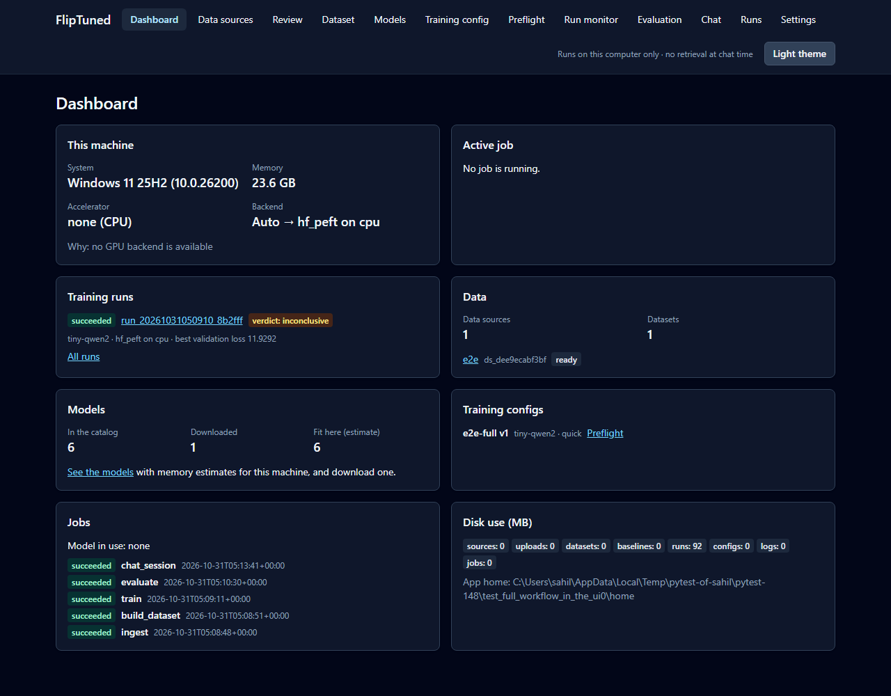
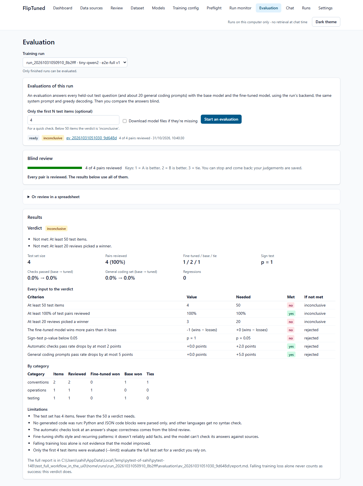

# FlipTuned

Version **v0.1.0** · Apache-2.0 · by Sahil ([@sahil1115](https://github.com/sahil1115))

**Limits first.** Fine-tuning does not reliably memorize documents or recall facts, and because FlipTuned
prohibits retrieval at inference time, this is a structural limit, not a tuning problem. The model keeps its
pretraining knowledge, so its answers do not come only from your organization's data. It cannot check its
answers against sources and must not be trusted to produce citations, policies, API names, file paths or
decisions. New data means rebuilding the dataset and retraining.

FlipTuned turns approved historical Q&A into a fine-tuning dataset, fine-tunes a small open-weight model
with LoRA on the hardware you have (NVIDIA CUDA, Apple Silicon MLX, or CPU), measures whether fine-tuning
helped, and lets you chat with the result. Everything runs on your machine: the data, training,
evaluation, chat and the web UI. Nothing is sent anywhere except package installs and model downloads
from Hugging Face that you allow.

What it's good for: adapting a small code model to your approved answer style, coding conventions and
recurring solution patterns. What it isn't: a search engine over your documents.

## 1. Platforms and hardware

| Machine | Backend | What you get |
|---|---|---|
| Windows 10/11 x64 or Linux with an NVIDIA GPU (driver ≥ 580, RTX 20-series / T4 or newer) | `hf_peft` on CUDA | 4-bit QLoRA; models up to a few billion parameters depending on VRAM |
| macOS 14+ on Apple Silicon | `mlx` | LoRA on 4-bit models in unified memory |
| Anything else (Windows, macOS, Linux, CPU only) | `hf_peft` on CPU | testing and models up to about 1B parameters; slow |

FlipTuned picks the backend automatically and `fliptuned doctor` tells you which one and why. You
need about 40 GB of free disk for real fine-tuning (model cache, checkpoints, exports).

**Run so far:** Windows 11 on CPU only. The CUDA and MLX paths are written and unit-tested with fakes,
but have **never been run** on real hardware. See [section 13](#13-known-limitations).

Details (CUDA drivers, bitsandbytes, memory tips per device, the Rosetta check on Macs):
[docs/platforms.md](docs/platforms.md).

## 2. Install

You need [uv](https://docs.astral.sh/uv/) and git; uv installs Python 3.12 itself if needed.
[Node.js](https://nodejs.org/) 22 is needed only to build the web UI. Get the source (clone or unzip),
open a terminal in the folder, and ask FlipTuned which install fits this machine:

```text
uv run fliptuned doctor --suggest-install
```

Then run the matching command:

| OS and hardware | Command |
|---|---|
| Windows or Linux, NVIDIA GPU | `uv sync --extra cuda --extra qlora --extra web` |
| macOS on Apple Silicon | `uv sync --extra mlx --extra cpu --extra web` |
| Windows, macOS or Linux, CPU only | `uv sync --extra cpu --extra web` |

Add `--extra dev` for the test tools. Build the web UI once:

```text
npm --prefix web ci
npm --prefix web run build
```

Check the result with `uv run fliptuned doctor`. Installed and run so far: Windows 11 CPU
(`--extra cpu --extra web --extra dev`). The CUDA and MLX commands resolve (`uv sync --dry-run`
on Windows) but have **not been installed** on matching hardware.

**One-command start, and shortcuts.** `uv run fliptuned serve` starts the app on every OS. Optional
shortcuts so you don't need a terminal in the project folder:

- **macOS / Linux:** add an alias to `~/.zshrc` or `~/.bashrc`, with your project path, then open a
  new terminal and run `fliptuned-ui`:

  ```text
  alias fliptuned-ui='uv run --project ~/FlipTuned fliptuned serve'
  ```

- **Windows:** double-click `scripts\fliptuned-serve.cmd` (extra arguments go to `serve`, e.g.
  `scripts\fliptuned-serve.cmd --port 8780`). To add it to the Start menu, run this once in
  PowerShell with your project path:

  ```text
  $s = (New-Object -ComObject WScript.Shell).CreateShortcut("$env:APPDATA\Microsoft\Windows\Start Menu\Programs\FlipTuned.lnk")
  $s.TargetPath = "C:\path\to\FlipTuned\scripts\fliptuned-serve.cmd"
  $s.Save()
  ```

  Close the console window (or press Ctrl+C) to stop the server; running jobs keep going.

The alias was tested in Git Bash on Windows (not yet on macOS or Linux); the `.cmd` and the shortcut
snippet were tested on Windows 11.

## 3. Quick start on synthetic data

The repository ships synthetic Q&A in `tests/fixtures/`. Use the app home `./.dev-home` for trying
things out, so nothing mixes with your real data in `~/.fliptuned`:

```text
uv run fliptuned serve --home ./.dev-home
```

In the browser: **Settings** → turn on developer mode (shows the tiny test model) → **Data sources** →
add the `tests/fixtures` folder → scan → ingest → **Review** → approve → **Dataset** → build with
`tiny-qwen2` → **Training config** → save and preflight → start → watch the **run monitor** →
**Evaluation** → **Chat**. On a laptop CPU this takes a few minutes; the tiny model's answers are
nonsense, it's only there to exercise the pipeline.

The same on the command line is in [section 5](#5-cli-pipeline).

## 4. The web app

```text
uv run fliptuned serve                                    # opens http://127.0.0.1:8765/#token=...
uv run fliptuned serve --home ./.dev-home --no-browser    # print the link instead
```

The server listens on 127.0.0.1 only, answers only requests for `127.0.0.1:<port>` or
`localhost:<port>`, and every API call needs the access token in the printed link (new for every
launch). If port 8765 is taken it uses the next free one; the port can be changed in Settings or with
`--port`. Without a UI build, `serve` shows a placeholder page.



| Screen | What you do there |
|---|---|
| Dashboard | This machine and its backend, the active job, latest runs with verdicts, data, models, disk use |
| Data sources | Allow a folder or upload files, scan, map columns, ingest with live progress |
| Review | Filter, read and approve or reject records (one at a time or in bulk); privacy findings are redacted |
| Dataset | Build grouped train/valid/test splits; statistics, warnings and exclusions |
| Models | The catalog, what fits on this machine (estimates), downloads |
| Training config | Beginner view, Advanced settings with an explanation for every field, versioned configs |
| Preflight | Every check with pass/warn/fail and what to do; Start training |
| Run monitor | Live loss chart, best checkpoint, ETA, peak memory, log, Cancel and Resume |
| Evaluation | Base vs fine-tuned, blind A/B review with keys 1/2/3, the verdict and why |
| Chat | Streamed chat with the fine-tuned or base model; nothing is logged |
| Runs | History, compare two runs, artifacts, export, archive, delete |
| Settings | Allowed folders, idle timeout, port, developer mode, the doctor report |

The full walkthrough with screenshots from the end-to-end tests: [docs/ui-guide.md](docs/ui-guide.md).
The HTTP API: [docs/api.md](docs/api.md).

## 5. CLI pipeline

Every command has `--help`, prints counts and statistics (never record text), exits non-zero on
failure, and accepts `--home` (default `~/.fliptuned`, or `FLIPTUNED_HOME`).

| Command | What it does |
|---|---|
| `doctor [--suggest-install]` | Machine, accelerator, installed packages, chosen backend and why |
| `status` | Datasets, runs, active job, latest verdicts, disk use |
| `scan <dir>` | Counts and types of files in a folder, without reading their content |
| `ingest --config <file>` | CSV / XLSX / Markdown / TXT → normalized records, with quality and privacy flags |
| `data-audit [--processed <dataset>]` | Statistics about the records or a built dataset |
| `review export --out <file>` / `review import <file>` | Approve or reject records in a spreadsheet |
| `build-dataset --config <file>` / `validate-dataset <dataset>` | Grouped train/valid/test splits |
| `models list` | The model catalog and what fits on this machine (estimates) |
| `train --config <file> [--dry-run]` | Preflight checks, then LoRA training as a job |
| `configs list \| show <name> \| duplicate <name> <new>` | Saved, versioned training configs |
| `jobs list \| follow <job> \| cancel <job> \| resume <run> \| selftest` | Background jobs |
| `evaluate --run <run>` / `--score <sheet>` / `--baseline-only --dataset <dataset>` | Base vs fine-tuned, blind review, verdict |
| `chat --run <run> [--base] [--prompt "..."]` | Talk to the model (weights only, nothing logged) |
| `export --run <run> [--merge]` | Adapter + metadata; optionally a merged standalone model |
| `serve [--port 8765] [--no-browser]` | The local web app and API on 127.0.0.1 only |

The whole pipeline on the synthetic fixtures (every line was run in a fresh `./.dev-home` on Windows 11
CPU, about 25 minutes in all, most of it the evaluation's generation):

```text
uv run fliptuned scan tests/fixtures --home ./.dev-home
uv run fliptuned ingest --config configs/ingest.sample.yaml --home ./.dev-home
uv run fliptuned ingest --config configs/ingest-synthetic.sample.yaml --home ./.dev-home
uv run fliptuned review export --out ./.dev-home/review.csv --status pending_review --home ./.dev-home
#   fill in the 'decision' column (approved / rejected / pending_review), then:
uv run fliptuned review import ./.dev-home/review.csv --home ./.dev-home
uv run fliptuned build-dataset --config configs/dataset.sample.yaml --allow-download --home ./.dev-home
uv run fliptuned validate-dataset fixtures --home ./.dev-home
uv run fliptuned train --config configs/train.sample.yaml --allow-download --home ./.dev-home
uv run fliptuned evaluate --run <run_id> --config configs/evaluate.sample.yaml --home ./.dev-home
#   fill in the 'judgement' column of the review sheet it prints (A, B or tie), then:
uv run fliptuned evaluate --run <run_id> --score <review_sheet.csv> --home ./.dev-home
uv run fliptuned chat --run <run_id> --prompt "How do I read a CSV file in Python?" --home ./.dev-home
uv run fliptuned export --run <run_id> --home ./.dev-home
```

`ingest`, `build-dataset`, `train` and `evaluate` run as jobs: the command waits and prints the
result, or returns at once with `--detach`. Jobs keep running if the terminal closes:

```text
uv run fliptuned jobs list --home ./.dev-home
uv run fliptuned jobs follow <job_id> --home ./.dev-home      # Ctrl+C stops following, not the job
uv run fliptuned jobs cancel <job_id> --home ./.dev-home      # stops at the next step, keeps a checkpoint
uv run fliptuned jobs resume <run_id> --home ./.dev-home      # continue a cancelled or interrupted run
```

Only one job that loads a model (training, evaluation, chat, merge) runs at a time; a second one is
refused with the ID of the job holding the model.

For real data, leave out `--home` and keep your own configs in `configs/local/` (git-ignored).

## 6. Checks before you train: doctor, data-audit, preflight

```text
uv run fliptuned doctor --home ./.dev-home                      # the machine; never opens data folders
uv run fliptuned data-audit --home ./.dev-home                  # records: counts, lengths, flags, duplicates
uv run fliptuned data-audit --processed fixtures --home ./.dev-home    # a built dataset
uv run fliptuned train --config configs/train.sample.yaml --dry-run --home ./.dev-home   # preflight only
```

- **doctor:** OS, CPU, RAM, accelerator, packages, disk space for the app home and the model cache,
  which backend will be used and why, and warnings (e.g. Windows long paths).
- **data-audit:** numbers only, never text: records by status, length percentiles, quality flags,
  privacy findings by type, duplicates; for a dataset, per-split sizes and token lengths.
- **Preflight:** dataset, system prompt, model, backend, memory (estimate), CPU size limit, model
  files, disk, the chat-template test on real training examples, the update count and a CPU time
  estimate. Training doesn't start while any check fails.

Secrets (API keys, tokens, passwords, private keys, connection strings) are found during ingest;
by default (`privacy.policy: exclude`) such records are left out, and reports show only the type and
location, never the value.

## 7. Choosing a model

```text
uv run fliptuned models list --home ./.dev-home
```

| Catalog ID | Parameters | License | Notes |
|---|---|---|---|
| `qwen2.5-coder-0.5b` | 0.49B | Apache-2.0 | fits a CPU; good first try |
| `qwen3-0.6b` | 0.60B | Apache-2.0 | |
| `qwen2.5-coder-1.5b` | 1.54B | Apache-2.0 | over the default CPU limit |
| `qwen3-1.7b` | 2.03B | Apache-2.0 | |
| `qwen3.5-2b` | 2.27B | Apache-2.0 | |
| `tiny-qwen2` | 0.002B | none stated | test-only; shown in developer mode |

`models list` (and the Models screen) shows, per model, the backends this machine has a version for,
the download size, whether it's downloaded, whether its chat template passed the prefix test, and
`fits` / `tight` / `won't fit` from the catalog's **estimate** of peak training memory. Start with the
smallest model that fits; a bigger one is worth it only if evaluation says the small one isn't good
enough. Models download only when you allow it (`--allow-download` or the UI's download button).

## 8. Evaluation and the verdict

```text
uv run fliptuned evaluate --run <run_id> --config configs/evaluate.sample.yaml --home ./.dev-home
uv run fliptuned evaluate --run <run_id> --score <review_sheet.csv> --home ./.dev-home
```

The base model and the fine-tuned model answer the held-out test set and about 20 general coding
prompts, with the same system prompt and greedy decoding, through the run's backend. Automatic checks
look at each answer's shape (empty, looping, cut off, code fences, language tag, Python/JSON syntax;
code is parsed, never run). Then you compare the two answers for every test item **blind**: they appear
as A and B in random order, and which model wrote which is revealed only when scoring. Review in the
UI (keys 1/2/3) or fill in `review_sheet.csv`.

The verdict is `accepted`, `rejected` or `inconclusive`, from an exact sign test and the limits in
the evaluate config (at least 50 test items, every pair reviewed, at least 20 non-tied pairs, no
category losing badly, automatic checks and general coding not dropping more than allowed).
`report.md` lists every input to it. With fewer than 50 test items (as with the fixtures) the verdict
is always `inconclusive`. Falling training loss alone doesn't mean the model got better. Details:
[docs/evaluation.md](docs/evaluation.md).



## 9. Chat and export

```text
uv run fliptuned chat --run <run_id> --home ./.dev-home                  # interactive; /reset, /exit
uv run fliptuned chat --run <run_id> --prompt "How do I ...?" --home ./.dev-home
uv run fliptuned chat --run <run_id> --base --prompt "How do I ...?" --home ./.dev-home   # the base model
uv run fliptuned export --run <run_id> --home ./.dev-home                # adapter + metadata
uv run fliptuned export --run <run_id> --merge --home ./.dev-home        # also a merged standalone model
```

Chat sends the model only the fixed system prompt (the one it was trained with) and your
conversation: no documents, no dataset records, no search, no external service. Nothing you type is
written to disk. The model stays loaded while you chat and is released after 10 minutes without a
message (the idle timeout in Settings).

An export holds the adapter, the training config, the run metadata and `export.json` (base model repo
and exact revision, license, backend, chat-template settings and the exact system prompt to use).
`--merge` adds `merged/`, a standalone model, and compares five greedy answers before and after
merging (`merge_check.json`). QLoRA runs are merged into the full-precision base, so their answers can
differ slightly; the check shows by how much.

## 10. Retraining

The model only knows what it was trained on. When you have new or changed Q&A:

```text
uv run fliptuned ingest --config configs/ingest-synthetic.sample.yaml --overwrite --home ./.dev-home
uv run fliptuned review export --out ./.dev-home/review-new.csv --status pending_review --home ./.dev-home
uv run fliptuned review import ./.dev-home/review-new.csv --home ./.dev-home
uv run fliptuned build-dataset --config configs/dataset.sample.yaml --home ./.dev-home
uv run fliptuned train --config configs/train.sample.yaml --home ./.dev-home
uv run fliptuned evaluate --run <new_run_id> --config configs/evaluate.sample.yaml --home ./.dev-home
```

- `ingest --overwrite` replaces that source's records; earlier review decisions stay with records
  whose content didn't change, and changed records go back to review.
- A dataset's ID comes from its inputs, so changed data gives a new dataset; the old one and the runs
  trained on it stay. If nothing changed, `build-dataset` says so.
- A training config without `dataset_id` uses the most recent dataset. Every run records the exact
  dataset and config version it used.
- Compare the old and new run in **Runs → Compare**: metrics, verdicts and every setting that differs.
- If you looked at test-set results and then changed the data, the evaluation report notes it.

## 11. Licensing

- FlipTuned itself is licensed under Apache-2.0 (see [LICENSE](LICENSE)).
- Each base model has its own license, shown in `models list`, on the Models screen and in every
  export's `export.json`. The catalog's models are Apache-2.0; the tiny test model states no license
  and is for tests only.
- You are responsible for having permission to use your Q&A data and for following the base model's
  license when you use or share a fine-tuned model.

## 12. Privacy

- No telemetry: `HF_HUB_DISABLE_TELEMETRY=1`, `report_to="none"`, no trackers, no crash reporters.
  The web UI bundles every asset (no CDNs or web fonts).
- Model commands run offline (`HF_HUB_OFFLINE=1`); downloads happen only when you allow them.
- Logs hold counts, metrics and messages, never record or chat text (unless you explicitly turn on
  content debug logging for an ingest).

More: [docs/privacy.md](docs/privacy.md) and [docs/architecture.md](docs/architecture.md).

## 13. Known limitations

- **Never run on real hardware:** the `mlx` backend (Apple Silicon) and `hf_peft` on CUDA (training,
  QLoRA, evaluation, chat, merge). Both are written from the libraries' documentation and source and
  tested with fakes only. Expect fixes on first use.
- **Never run on macOS or Linux** at all; CI is configured for all three OSes but its results are not
  part of this record.
- CPU training is slow and limited to about 1B parameters by default.
- Fine-tuning shapes style and recurring patterns; it doesn't make the model know your documents
  (see the first paragraph).
- With fewer than 50 test items the verdict is always `inconclusive`.
- One user, one machine: the server binds 127.0.0.1 only, with no option to share it.
- One model job at a time (training, evaluation, chat or merge).
- Two tests that create symlinks are skipped on Windows without Developer Mode.

## 14. Tests

```text
uv sync --extra cpu --extra web --extra dev    # or the extras for your machine
uv run ruff check .
uv run pytest                                  # offline suite; never downloads a model
uv run pytest -m tiny                          # downloads a tiny test model (a few MB)
uv run pytest -m "mlx or cuda or slow"         # hardware-specific and long tests
npm --prefix web ci
npm --prefix web run lint
npm --prefix web run test
npm --prefix web run build
uv run playwright install chromium             # once, for the end-to-end tests
uv run pytest -m e2e                           # Playwright against a real server
```

Results for v0.1.0 (2026-10-31):

| Check | Windows 11, CPU (`hf_peft`) | macOS, Apple Silicon (`mlx`) | Linux / Windows, NVIDIA (`hf_peft` CUDA) |
|---|---|---|---|
| `ruff check .` | passed | not run | not run |
| `pytest` (offline suite) | 429 passed, 2 skipped (symlinks need Developer Mode) | not run | not run |
| `pytest -m tiny` | 11 passed (CPU training → cancel → resume → evaluate → chat → merge, plus the UI flows marked `tiny`) | not run | not run |
| `pytest -m "mlx or cuda or slow"` | 6 passed (catalog template tests), 5 skipped (MLX: needs Apple Silicon; CUDA: no GPU) | not run | not run |
| Web lint / Vitest / build | passed / 64 passed / passed | not run | not run |
| `pytest -m e2e` | 4 passed, 1 skipped (the MLX variant: needs Apple Silicon) | not run | not run |

No browser request in the E2E runs left `127.0.0.1`.

Development and tests use `./.dev-home` or pytest temp folders, never `~/.fliptuned`.

## Contributors

- Sahil ([@sahil1115](https://github.com/sahil1115)): author and maintainer

## Changelog

- **v0.1.0** (2026-10-31): first release. Data ingestion with quality and secret checks, review,
  grouped dataset builds, LoRA training (`hf_peft` on CPU/CUDA, `mlx` on Apple Silicon), blind
  evaluation with a verdict, chat and export, the CLI and the local web UI.
